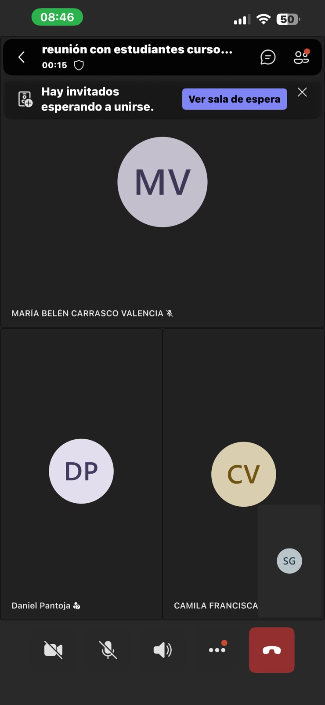

# S09 - Reunión con SERNAGEOMIN y resolución de dudas

**Fecha:** 06-10-2026  
**Participantes:** BENJAMÍN JARPA, SEBASTIÁN MEDALLA, PABLO TRONCOSO 

**Responsable del registro:** CÉSAR OLIVARES

## Objetivo

Resolver dudas y vacíos de información sobre el proyecto PluvioTech mediante una reunión en línea con SERNAGEOMIN, utilizando el listado de preguntas elaborado previamente por el equipo.

## Actividades realizadas

1. Revisión del listado de preguntas desarrolladas por el equipo en sesiones anteriores.
2. Reunión en línea con representantes de SERNAGEOMIN.
3. Presentación de las principales dudas sobre el problema, la red comunitaria de monitoreo, la información disponible y las condiciones del territorio.
4. Recepción de respuestas y orientaciones por parte de SERNAGEOMIN.
5. Registro de los principales hallazgos y acuerdos obtenidos durante la reunión.

## Evidencias

- Enlace al listado de preguntas: [URL]

## Resultados

- Se realizó una reunión en línea con SERNAGEOMIN para aclarar dudas que el equipo tenía desde etapas anteriores del proyecto.
- Las preguntas permitieron obtener información más precisa sobre el contexto del problema, la red comunitaria de observadores y las condiciones de monitoreo en San José de Maipo.
- Se identificaron aspectos que ya cuentan con mayor claridad y otros que requieren seguir siendo investigados.
- La reunión aportó antecedentes útiles para avanzar en la definición del problema y en el diseño de la solución.

## Decisiones y justificación

| Decisión | Evidencia o criterio | Consecuencia para el proyecto |
|---|---|---|
| Utilizar el listado de preguntas previamente elaborado para estructurar la reunión | El equipo contaba con dudas definidas desde sesiones anteriores | La reunión permitió abordar de manera ordenada los principales vacíos de información |
| Registrar las respuestas y orientaciones entregadas por SERNAGEOMIN | La información obtenida es relevante para el diseño del proyecto | Las próximas decisiones podrán basarse en información más precisa |
| Mantener la investigación sobre temas que siguen sin resolverse | No todas las dudas pudieron ser respondidas completamente | Se deberá continuar con búsqueda de fuentes y posibles nuevos contactos |

## Errores, dificultades o riesgos

- Algunas preguntas pudieron requerir información adicional o respuestas más específicas.
- Existe el riesgo de interpretar de manera incompleta la información entregada durante la reunión.
- Aún pueden existir vacíos relacionados con las necesidades de los usuarios, las condiciones de conectividad y los requisitos técnicos de la solución.
- Para reducir estos riesgos, se deberá documentar la reunión, revisar las respuestas en equipo y contrastar la información con otras fuentes.

## Aprendizajes

- El contacto directo con SERNAGEOMIN permite obtener información institucional y contextual que no siempre está disponible en fuentes públicas.
- Contar con un listado previo de preguntas facilita aprovechar mejor las reuniones con actores clave.
- La validación de información con instituciones ayuda a diferenciar entre datos comprobados, supuestos y temas pendientes.
- La reunión permitió avanzar en la comprensión del problema y en la definición de los próximos pasos del proyecto.

## Tareas y responsables

| Tarea | Responsable(s) | Fecha límite | Estado |
|---|---|---|---|
| Organizar y sintetizar las respuestas obtenidas en la reunión | SEBASTIÁN MEDALLA, PABLO TRONCOSO  | 09-10-2026 | Realizado |
| Actualizar el listado de preguntas con las respuestas recibidas | SEBASTIÁN MEDALLA, PABLO TRONCOSO  | 09-10-2026 | Realizado |
| Identificar dudas o vacíos que permanecen sin resolver | SEBASTIÁN MEDALLA, PABLO TRONCOSO  | 09-10-2026 | Realizado |
| Incorporar la información obtenida en la definición del problema | SEBASTIÁN MEDALLA, PABLO TRONCOSO  | 09-10-2026 | Realizado |

## Próximo paso

El próximo paso será analizar y organizar la información entregada por SERNAGEOMIN, actualizando el listado de preguntas y los antecedentes del proyecto.

La evidencia de avance será un documento con las respuestas principales, las dudas resueltas y los temas que requieren mayor investigación.

## Fuentes consultadas

- SERNAGEOMIN, reunión en línea realizada el 06-10-2026.
- Listado de preguntas elaborado por el equipo en sesiones anteriores.
- Documentos o material compartido por SERNAGEOMIN durante la reunión