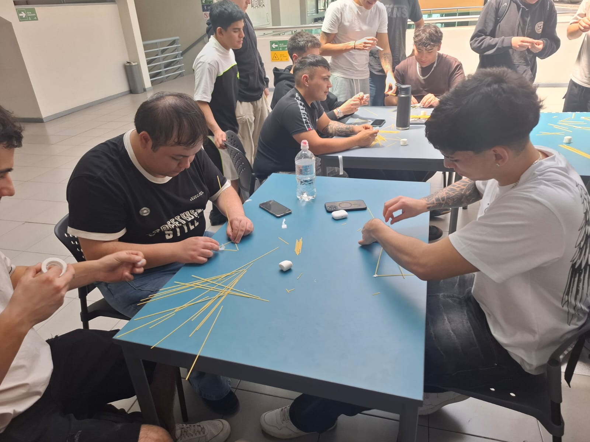
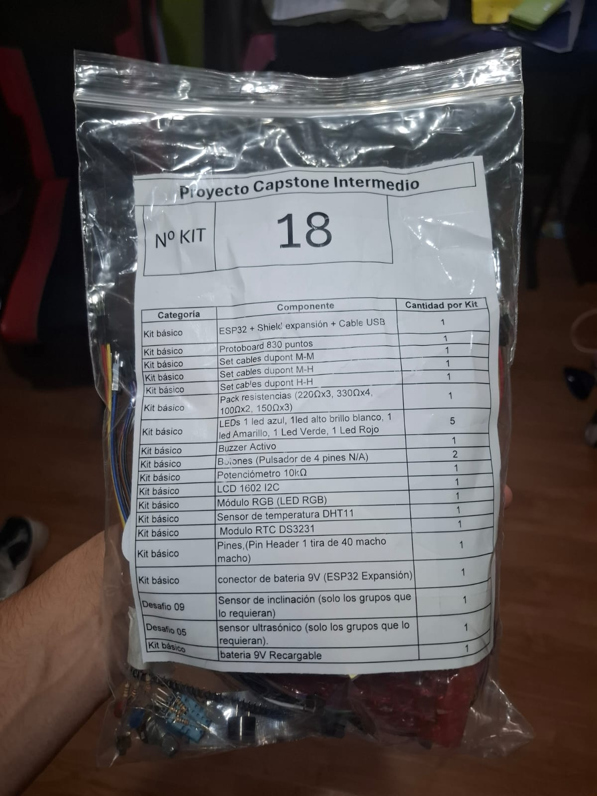

# S13 - Trabajo colaborativo y entrega de materiales

**Fecha:** 05-11-2026
**Participantes:** BENJAMÍN JARPA, SEBASTIÁN MEDALLA, CÉSAR OLIVARES, PABLO TRONCOSO 

**Responsable del registro:** CÉSAR OLIVARES

## Objetivo

Practicar el trabajo colaborativo mediante la construcción de una torre, conocer propuestas de solución de otros equipos y recibir los materiales entregados por la universidad.

## Actividades realizadas

1. Construcción en equipo de una torre utilizando 18 fideos, buscando alcanzar la mayor altura posible y sostener un malvavisco en la punta.
2. Trabajo en el diseño y armado de una estructura que resistiera el peso del malvavisco.
3. Participación como audiencia en las presentaciones de soluciones de algunos grupos. Nuestro equipo no alcanzó a presentar durante la sesión.
4. Recepción del kit de materiales entregado por la universidad para el desarrollo del prototipo.

## Evidencias

- Fotografía de trabajo en equipo: 
- Fotografía o inventario del kit recibido: 

## Resultados

- Se trabajó colaborativamente en la construcción de una torre con recursos limitados.
- El desafío permitió poner en práctica la coordinación y la toma de decisiones durante el armado.
- Se conocieron propuestas de solución de otros equipos.
- La presentación de PluvioTech quedó pendiente.
- Se recibieron materiales que deberán revisarse para determinar cómo incorporarlos al prototipo.

## Decisiones y justificación

| Decisión | Evidencia o criterio | Consecuencia para el proyecto |
|---|---|---|
| Se dicidio utilizar prismas para llegar a mayor altura y estabilidad en base | Se utilizaban menos materiales y se podía llegar a mas altura | Que con materiales limitados cuesta realizar un avance o llegar a un producto pulcro |
| Se recibio pequeña capacitación del uso de ESP32 junto a sus componentes y uso | Necesidad de conocer los recursos disponibles | Identificar qué partes del prototipo pueden construirse y qué materiales faltan |

## Errores, dificultades o riesgos

- El desafío exigía equilibrar altura y estabilidad con solo 18 fideos.
- No se alcanzó a presentar la solución de PluvioTech.
- Todavía debe comprobarse si los materiales recibidos cubren las necesidades del prototipo.

## Aprendizajes

- La construcción permitió reflexionar sobre la importancia de probar una estructura y ajustar su diseño según su comportamiento.
- El trabajo con recursos limitados requiere coordinación y priorización.
- Para avanzar con PluvioTech, será necesario adaptar la propuesta a los materiales disponibles sin perder de vista el problema principal.

## Tareas y responsables

| Tarea | Responsable(s) | Fecha límite | Estado |
|---|---|---|---|
| Revisar y registrar los materiales recibidos | CÉSAR OLIVARES | 05-11-2026 | Realizado |
| Comparar el kit con los requerimientos del prototipo | CÉSAR OLIVARES | 05-11-2026 | Realizado |
| Coordinar la presentación pendiente de PluvioTech | CÉSAR OLIVARES | 05-11-2026 | Realizado |

## Próximo paso

Revisar el kit recibido y determinar qué funciones de la solución pueden desarrollarse con sus componentes. La evidencia será un inventario y una propuesta inicial de adaptación del prototipo.

## Fuentes consultadas

- Instrucciones de la actividad de construcción de la torre.
- Listado de materiales entregado por la universidad.